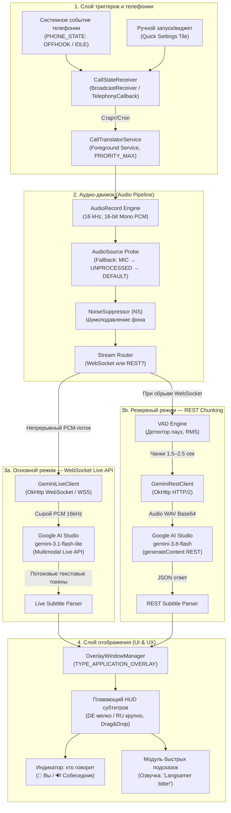
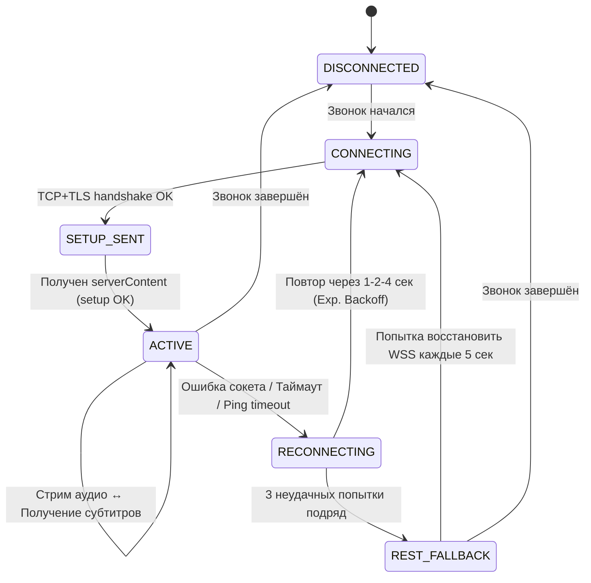

# ТЕХНИЧЕСКОЕ ЗАДАНИЕ (ТЗ) v2.0
## Разработка мобильного приложения синхронного перевода звонков «CallSub DE-RU» для ОС Android

> [!IMPORTANT]
> **Версия 2.0** — исправлены все критические ошибки и серьёзные замечания по результатам профессионального аудита от 16.10.2026.

---

## 1. Общие сведения и назначение системы

### 1.1. Наименование проекта
* **Рабочее название:** CallSub DE-RU (Call Subtitles German-to-Russian).
* **Платформа:** Android (минимальная версия: Android 8.0 Oreo / API 26, целевая: Android 15 / API 35).
* **Основной стек:** Kotlin, Coroutines/Flow, OkHttp 4 (HTTP/2 & WebSockets), Android Jetpack, WindowManager Overlay API, **Google AI Studio (линейка Gemini 3: `gemini-3.1-flash-lite`, `gemini-3.8-flash`, `gemini-3.1-flash-live`)**.

### 1.2. Проблема и цель продукта
* **Проблема:** Люди, проживающие в Германии, Австрии или Швейцарии (DACH) с недостаточным уровнем немецкого языка (A1–B1), испытывают сильный языковой барьер и страх телефонных звонков (*Sprechangst*) при обращении в государственные инстанции (*Bürgeramt, Jobcenter, Ausländerbehörde*), страховые компании (*Krankenkasse*), банки, клиники и коммунальные службы. В телефонном разговоре отсутствуют визуальные подсказки, собеседники говорят быстро, используют бюрократический язык (*Amtsdeutsch*) и диалекты.
* **Цель:** Создать легковесное, высоконадежное приложение для Android, которое в автоматическом режиме во время телефонного звонка (входящего или исходящего) захватывает немецкую речь собеседника через микрофон при включённой громкой связи, передаёт непрерывный аудиопоток в **Google AI Studio (Gemini 3.1 Flash)** по протоколу WebSocket и выводит на экран смартфона поверх любого интерфейса звонилки живые субтитры на русском языке с минимальной задержкой (< 600 мс).

---

## 2. Архитектура системы и компонентов

Приложение строится по модульной событийно-ориентированной архитектуре (Clean Architecture / Service-driven Event Pipeline).



---

## 3. Детальные функциональные требования к модулям

### 3.1. Модуль телефонии и автозапуска (`CallStateReceiver` + `CallTracker`)

#### Автоматическое определение начала разговора:
* **Android 8–12 (API 26–32):** Прослушивание интента `android.intent.action.PHONE_STATE` через `BroadcastReceiver`. При переходе в `TelephonyManager.EXTRA_STATE_OFFHOOK` — запуск сервиса, при `EXTRA_STATE_IDLE` — остановка.
* **Android 13+ (API 33+):** Использование `TelephonyManager.registerTelephonyCallback()` с `TelephonyCallback.CallStateListener` вместо устаревшего `PhoneStateListener`. Разрешение `READ_PHONE_STATE` дополняется разрешением `READ_PHONE_NUMBERS`. В манифесте для `BroadcastReceiver` обязателен атрибут `android:exported="true"`.

#### Ручной режим:
* Кнопка-плитка в шторке быстрых настроек Android (*Quick Settings Tile*) для ручного включения перевода (для звонков в WhatsApp, Telegram, Skype и других VoIP-мессенджерах).

#### Обработка жизненного цикла:
* При `OFFHOOK`: запуск `CallTranslatorService`, открытие WebSocket, показ оверлея.
* При `IDLE`: остановка записи → закрытие WebSocket → скрытие оверлея → сохранение лога субтитров → освобождение ресурсов.

---

### 3.2. Аудио-подсистема (`AudioCaptureEngine`)

> [!CAUTION]
> **Принципиально важно:** `AcousticEchoCanceler` (AEC) **НЕ ВКЛЮЧАЕТСЯ**. AEC предназначен для подавления звука из динамика в микрофоне (чтобы собеседник не слышал своё эхо). В нашем случае звук из динамика — это именно то, что нам нужно захватить и перевести. Включение AEC уничтожит полезный сигнал.

#### Параметры аудиозахвата:
* Частота дискретизации: 16 000 Гц (16 kHz).
* Формат данных: PCM 16-bit, моно (Mono, 1 канал).
* Размер буфера: 2× минимального системного буфера `AudioRecord.getMinBufferSize()`.

#### Адаптивный выбор источника звука (AudioSource Probe):
Поведение `AudioSource` зависит от производителя, чипсета и версии Android. При инициализации запускается автоматический перебор источников с проверкой наличия реального сигнала:

```
Попытка 1: AudioSource.MIC
  → Запись 500 мс → Расчёт RMS
  → Если RMS > порог (сигнал есть) → Используем MIC ✅
  → Если RMS ≈ 0 (тишина) → Переход к попытке 2

Попытка 2: AudioSource.UNPROCESSED (API 24+)
  → Запись 500 мс → Расчёт RMS
  → Если RMS > порог → Используем UNPROCESSED ✅
  → Если тишина → Переход к попытке 3

Попытка 3: AudioSource.DEFAULT
  → Используем как последний вариант ✅
```

#### Аппаратные фильтры:
* **NoiseSuppressor:** ВКЛЮЧАЕТСЯ — подавляет фоновый шум (шум улицы, вентилятор), но **не подавляет голос из динамика**.
* **AcousticEchoCanceler:** **НЕ ВКЛЮЧАЕТСЯ** — см. предупреждение выше.
* **AutomaticGainControl:** ВКЛЮЧАЕТСЯ — нормализует громкость, компенсируя разницу в расстоянии от микрофона до динамика.

---

### 3.3. Маршрутизатор аудиопотока (`StreamRouter`)

Приложение поддерживает **два режима** передачи аудио в Google AI Studio. Переключение между ними происходит автоматически:

#### Режим A — Основной: WebSocket Live API (непрерывный стрим)
* Используется при стабильном интернет-соединении.
* Аудиопоток передаётся **непрерывно**, без локальной нарезки на чанки.
* **Локальный VAD НЕ используется** — серверный VAD Google самостоятельно определяет границы фраз и паузы говорящего.
* Переход в Режим B: при разрыве WebSocket (ошибка сокета, таймаут, смена сотовой вышки).

#### Режим B — Резервный: REST Chunking (пакетная отправка)
* Активируется автоматически при невозможности поддерживать WebSocket.
* **Локальный VAD ВКЛЮЧАЕТСЯ** для интеллектуальной нарезки:
  * Алгоритм: подсчёт среднеквадратичной амплитуды (RMS Energy Threshold).
  * Пауза > 400 мс после речевого сегмента → формирование чанка.
  * Максимальная длина чанка: 2.5 секунды (принудительная отсечка).
  * Минимальная длина чанка: 0.5 секунды (защита от микрофрагментов).
* Переход обратно в Режим A: автоматическая попытка переподключения WebSocket каждые 5 секунд.

---

### 3.4. Модуль интеграции с Google AI Studio (Актуальная линейка Gemini 3)

#### Актуальный модельный ряд (октябрь 2026 года):

| Модель | ID в API | Назначение в приложении | Режим |
|:---|:---|:---|:---|
| **Gemini 3.1 Flash-Lite** | `gemini-3.1-flash-lite` | Основной переводчик. Минимальная задержка, низкий трафик. | WebSocket Live API |
| **Gemini 3.8 Flash** | `gemini-3.8-flash` | Резервный переводчик. Максимальное понимание Amtsdeutsch. `thinkingLevel: "off"`. | REST Chunking |
| **Gemini 3.1 Flash Live** | `gemini-3.1-flash-live` | Специализированный стриминговый шлюз Live API. | WebSocket Live API |

#### Спецификация WebSocket Live API:
* **Протокол:** `WSS` (Stateful WebSocket Connection).
* **Endpoint:** `wss://generativelanguage.googleapis.com/ws/google.ai.generativelanguage.v1alpha.GenerativeService.BidiGenerateContent?key={API_KEY}`
* **Формат входного аудио:** Непрерывный поток PCM 16-bit, 16 kHz, Little-Endian, Mono.
* **Thinking Budget:** `thinkingLevel: "off"` или `thinking_budget: 0` — для мгновенного отклика без внутренних рассуждений модели.

#### Конечный автомат состояний WebSocket-сессии:



* **Heartbeat / Ping-Pong:** Клиент отправляет WebSocket Ping каждые 15 секунд. Если Pong не получен в течение 5 секунд — переход в `RECONNECTING`.
* **Лимит длительности сессии:** Live API может ограничивать одну сессию ~15–30 минутами. При серверном разрыве — автоматический бесшовный реконнект с новой сессией без потери субтитров.

#### Системный промпт (Setup Configuration):
```json
{
  "setup": {
    "model": "models/gemini-3.1-flash-lite",
    "generationConfig": {
      "responseModalities": ["TEXT"],
      "temperature": 0.1
    },
    "systemInstruction": {
      "parts": [{
        "text": "Ты — мгновенный синхронный переводчик немецких телефонных звонков на русский язык. На вход поступает живое аудио немецкой речи собеседника. Твоя задача — непрерывно возвращать в текстовом потоке ТОЛЬКО краткий и точный перевод услышанного на русский язык в виде субтитров. Не добавляй никаких комментариев, вводных слов и рассуждений. Только перевод на русский."
      }]
    }
  }
}
```

#### Спецификация REST Chunking Fallback:
* **Endpoint:** `https://generativelanguage.googleapis.com/v1beta/models/gemini-3.8-flash:generateContent?key={API_KEY}`
* **Payload:** Мультимодальный запрос с `inlineData` (Base64-кодированный WAV-чанк) + системный промпт.
* **Retry Policy:** Exponential Backoff при 429 / 503 (повтор через 500 мс → 1 с → 2 с).

#### Обработка исчерпания лимитов API:
* HTTP 429 (Rate Limit) → попытка переключения на резервную модель (`flash-lite` ↔ `flash`).
* HTTP 403 (Forbidden / Quota exceeded) → крупное красное уведомление на оверлее: *«⚠️ Лимит API исчерпан. Перевод приостановлен. Проверьте ключ в настройках.»*
* Блокировка повторных бесполезных запросов на 60 секунд для экономии трафика.

---

### 3.5. Плавающий интерфейс субтитров (`OverlayWindowManager`)

#### Системные параметры окна:
* **Тип:** `WindowManager.LayoutParams.TYPE_APPLICATION_OVERLAY`.
* **Флаги:**
  * `FLAG_NOT_FOCUSABLE` — оверлей не перехватывает ввод звонилки.
  * `FLAG_LAYOUT_IN_SCREEN` — отрисовка поверх статус-баров.
  * `FLAG_NOT_TOUCH_MODAL` — клики вне оверлея проходят сквозь.

#### Анатомия плавающего окна:
1. **Индикатор состояния:** цветной кружок:
   * 🟢 Зелёный — активное прослушивание, перевод работает.
   * 🟡 Жёлтый — переподключение сокета / ожидание ответа.
   * 🔴 Красный — ошибка сети или лимит API исчерпан.
2. **Индикатор говорящего:**
   * 🔊 — говорит собеседник (перевод активен, субтитры обновляются).
   * 🎤 — говорит пользователь (перевод на паузе, отображается предыдущий субтитр).
3. **Оригинал (Немецкий):** мелкий шрифт (13sp), светло-серый `#AAAAAA`.
4. **Перевод (Русский):** крупный полужирный шрифт (18–22sp), белый `#FFFFFF` на тёмной полупрозрачной подложке `#CC121212`, скругление 16dp.
5. **Панель быстрых действий:**
   * `[Аа]` — циклическое переключение масштаба (Маленький / Средний / Огромный).
   * `[🔊 Langsamer]` — озвучка экстренной фразы по-немецки (см. п. 3.6).
   * `[—]` — сворачивание в компактный Bubble у края экрана.

#### Физика перемещения (Drag & Drop):
* Обработка `MotionEvent.ACTION_DOWN` / `ACTION_MOVE` / `ACTION_UP`.
* Автоматическое «прилипание» к ближайшему краю экрана при отпускании (Magnetic edge snapping).
* Запоминание последней позиции в `SharedPreferences`.

---

### 3.6. Модуль экстренных фраз на немецком (`QuickPhrasesPlayer`)

Нажатие кнопки `[Langsamer]` проигрывает предзаписанный WAV-семпл (приоритет) или запускает системный `TextToSpeech (Locale.GERMANY)` в динамик громкой связи:

* **Фраза 1:** *"Entschuldigung, könnten Sie bitte etwas langsamer sprechen? Die Verbindung ist etwas schlecht."*
  → «Извините, не могли бы вы говорить чуть медленнее? Связь немного прерывается.»
* **Фраза 2:** *"Einen kleinen Moment bitte, ich notiere mir das kurz."*
  → «Секундочку, пожалуйста, я коротко это запишу.»

Во время воспроизведения фразы захват микрофона временно приостанавливается (чтобы TTS-голос не попал в Gemini как «речь собеседника»).

---

### 3.7. Экран настроек и Onboarding (`MainActivity` + `OnboardingActivity`)

#### Onboarding (Пошаговый визард первого запуска):
Запускается однократно при первой установке. 4 экрана:
1. **«Добро пожаловать»** — краткое описание + демо-анимация.
2. **«Разрешения»** — последовательный запрос всех Permission с визуальным объяснением каждого.
3. **«API-ключ»** — инструкция в 3 шага: зайти на aistudio.google.com → нажать Get API Key → вставить.
4. **«Тест микрофона»** — автоматический тест (см. п. 3.8).

#### Обработка отказа в разрешениях (Permission Denial):
Для каждого разрешения реализован трёхступенчатый механизм:
1. **Первый запрос:** Стандартный системный диалог.
2. **Повторный запрос** (если отклонено): Экран-объяснение с визуальной демонстрацией, зачем нужно, + кнопка «Разрешить».
3. **«Don't ask again»** (если `shouldShowRequestPermissionRationale == false`): Экран с кнопкой «Открыть настройки», которая ведёт в `Intent(Settings.ACTION_APPLICATION_DETAILS_SETTINGS)`.

Критические разрешения, без которых приложение не работает:
* `RECORD_AUDIO` — без него нет звука → блокирующий экран.
* `SYSTEM_ALERT_WINDOW` — без него нет оверлея → блокирующий экран.
* `READ_PHONE_STATE` + `READ_PHONE_NUMBERS` (API 33+) — без них нет автозапуска → предупреждение (ручной режим доступен).
* `REQUEST_IGNORE_BATTERY_OPTIMIZATIONS` — без него сервис может быть убит → рекомендация.

#### Безопасное хранение API-ключа:
* API-ключ хранится в `EncryptedSharedPreferences` (библиотека `androidx.security:security-crypto`).
* Ключ шифрования привязан к Android Keystore аппаратного модуля безопасности.
* Ключ никогда не передаётся в логи, Crash Reporter или сторонние SDK.

---

### 3.8. Модуль автоматического тестирования микрофона (`MicTestEngine`)

Запускается при первом запуске (Onboarding, шаг 4) и доступен из экрана настроек:

1. Приложение воспроизводит через динамик тестовый немецкий аудиоклип (3 секунды, предзаписанная фраза: *"Guten Tag, Ihr Termin ist am Freitag um zehn Uhr"*).
2. Параллельно записывает звук через микрофон.
3. Отправляет записанный аудио в Gemini.
4. Проверяет результат:
   * ✅ Если получен корректный перевод («Добрый день, ваш приём в пятницу в десять часов») → *«Микрофон работает отлично!»*
   * ⚠️ Если перевод неполный или искажён → *«Попробуйте увеличить громкость динамика или подключить гарнитуру»*.
   * ❌ Если тишина / ошибка → *«Микрофон не захватывает звук. Проверьте настройки»*.

---

### 3.9. История субтитров / Лог разговора (`TranscriptLogger`)

* По завершении каждого звонка весь текст субтитров (оригинал DE + перевод RU) сохраняется в зашифрованный локальный файл.
* Формат: JSON Lines, один файл на звонок, имя: `call_2026-10-16_14-35.jsonl`.
* Хранение: `Context.getFilesDir()` (внутреннее хранилище, недоступно другим приложениям).
* Доступ: из экрана настроек → «История звонков» → список с датой/временем → просмотр полного текста.
* Автоочистка: записи старше 30 дней удаляются автоматически.

---

## 4. Нефункциональные требования (NFR)

| Параметр | Требование | Обоснование |
| :--- | :--- | :--- |
| **Сквозная задержка (Latency)** | **< 600 мс** | Паузы между репликами в разговоре длятся 1–1.5 сек. Перевод должен появляться до ответа пользователя. |
| **Нагрузка на CPU** | **Не более 5–8%** | Старые телефоны (Snapdragon 430/625, MediaTek Helio P22) не должны греться. |
| **Оперативная память (RAM)** | **Не более 50–70 МБ** | Защита от Android Low Memory Killer (LMK). |
| **Расход мобильного трафика** | **~60–115 МБ в час** (сырой PCM 16kHz Mono) | PCM 16-bit 16 kHz = 32 000 байт/сек = ~115 МБ/час несжатого потока. При использовании кодека Opus (если поддерживается Live API) — ~15–20 МБ/час. **Пользователь предупреждается при первом запуске.** |
| **Приватность данных** | **Zero-Storage для аудио** | Аудиопоток не сохраняется на диск. Текстовые субтитры сохраняются локально в зашифрованном виде (опционально). |

> [!NOTE]
> При первом запуске приложение показывает предупреждение: *«При работе через мобильный интернет приложение расходует ~60–100 МБ в час. Рекомендуем использовать Wi-Fi для длительных звонков.»*

---

## 5. Системные разрешения (`AndroidManifest.xml`)

```xml
<!-- Захват звука с микрофона -->
<uses-permission android:name="android.permission.RECORD_AUDIO" />

<!-- Плавающее окно поверх экрана звонка -->
<uses-permission android:name="android.permission.SYSTEM_ALERT_WINDOW" />

<!-- Определение начала/окончания звонка (Android 8–12) -->
<uses-permission android:name="android.permission.READ_PHONE_STATE" />

<!-- Определение начала/окончания звонка (Android 13+) -->
<uses-permission android:name="android.permission.READ_PHONE_NUMBERS" />

<!-- Интернет для связи с Google AI Studio -->
<uses-permission android:name="android.permission.INTERNET" />

<!-- Foreground Service с типом микрофон -->
<uses-permission android:name="android.permission.FOREGROUND_SERVICE" />
<uses-permission android:name="android.permission.FOREGROUND_SERVICE_MICROPHONE" />

<!-- Защита от агрессивного энергосбережения -->
<uses-permission android:name="android.permission.REQUEST_IGNORE_BATTERY_OPTIMIZATIONS" />

<!-- Уведомления (Android 13+) -->
<uses-permission android:name="android.permission.POST_NOTIFICATIONS" />

<!-- BroadcastReceiver для телефонии -->
<receiver
    android:name=".service.CallStateReceiver"
    android:exported="true">
    <intent-filter>
        <action android:name="android.intent.action.PHONE_STATE" />
    </intent-filter>
</receiver>
```

---

## 6. Анализ рисков и сценарии сбоев (Edge Cases)

1. **Кратковременный обрыв мобильного интернета (3G/4G):**
   * Автоматический переход WebSocket → REST Fallback.
   * Локальный кольцевой буфер хранит 3 последних аудиочанка.
   * На оверлее индикатор горит жёлтым: *«Переподключение...»*.

2. **Пользователь говорит одновременно с собеседником (Double-talk):**
   * Микрофон захватывает оба голоса. Gemini получает смешанный сигнал.
   * В системный промпт заложена инструкция: переводить только немецкую речь, игнорируя фрагменты на русском.
   * Индикатор 🎤/🔊 подсказывает пользователю, когда лучше молчать.

3. **Агрессивное энергосбережение вендоров (Xiaomi MIUI, Huawei EMUI, Samsung One UI):**
   * Foreground Service с `FOREGROUND_SERVICE_TYPE_MICROPHONE`.
   * Запрос `REQUEST_IGNORE_BATTERY_OPTIMIZATIONS`.
   * Onboarding-экран с инструкцией: «Для Xiaomi: Настройки → Приложения → CallSub → Автозапуск → Включить».

4. **Лимит длительности WebSocket-сессии Google (15–30 минут):**
   * При серверном разрыве — мгновенный автоматический реконнект с новым `setup` без потери субтитров.

5. **Микрофон не захватывает звук из динамика (конкретная модель телефона):**
   * Автоматический перебор `AudioSource` (MIC → UNPROCESSED → DEFAULT).
   * Если ни один не работает — предупреждение: *«Ваш телефон блокирует запись звука во время звонка. Попробуйте подключить проводные наушники с микрофоном.»*

6. **API-ключ заблокирован / лимит исчерпан посреди разговора:**
   * Красный баннер на оверлее: *«⚠️ Лимит API исчерпан»*.
   * Автоматическая попытка переключиться на резервную модель.
   * Блокировка повторных запросов на 60 секунд.

---

## 7. Структура проекта

```
app/src/main/
├── AndroidManifest.xml
├── java/com/callsub/translator/
│   ├── audio/
│   │   ├── AudioCaptureEngine.kt       # AudioRecord + AudioSource Probe
│   │   ├── AudioSourceProbe.kt         # Fallback-цепочка: MIC → UNPROCESSED → DEFAULT
│   │   └── VoiceActivityDetector.kt    # VAD (только для REST-режима)
│   ├── network/
│   │   ├── GeminiLiveClient.kt         # WebSocket Live API клиент
│   │   ├── GeminiRestClient.kt         # REST Chunking Fallback клиент
│   │   ├── StreamRouter.kt             # Маршрутизатор: WebSocket ↔ REST
│   │   └── ConnectionStateMachine.kt   # Конечный автомат состояний соединения
│   ├── service/
│   │   ├── CallTranslatorService.kt    # Foreground Service (ядро приложения)
│   │   ├── CallStateReceiver.kt        # BroadcastReceiver + TelephonyCallback
│   │   └── QuickSettingsTile.kt        # Плитка в шторке уведомлений
│   ├── ui/
│   │   ├── OverlayManager.kt           # Плавающее окно через WindowManager
│   │   ├── MainActivity.kt             # Экран настроек
│   │   ├── OnboardingActivity.kt       # Визард первого запуска
│   │   └── TranscriptViewActivity.kt   # Просмотр истории субтитров
│   ├── tts/
│   │   └── QuickPhrasesPlayer.kt       # Озвучка экстренных фраз
│   ├── storage/
│   │   ├── SecureKeyStorage.kt         # EncryptedSharedPreferences для API-ключа
│   │   └── TranscriptLogger.kt         # Зашифрованный лог субтитров
│   └── test/
│       └── MicTestEngine.kt            # Автотест микрофона при первом запуске
└── res/
    ├── layout/
    │   ├── overlay_subtitles.xml        # Layout плавающего окна
    │   ├── activity_main.xml            # Экран настроек
    │   └── activity_onboarding.xml      # Визард
    └── raw/
        ├── test_phrase_de.wav           # Тестовый немецкий аудиоклип
        ├── phrase_langsamer.wav         # «Könnten Sie langsamer sprechen?»
        └── phrase_moment.wav            # «Einen Moment bitte»
```

---

## 8. План и этапы разработки

| Этап | Название | Описание | Результат |
|:---|:---|:---|:---|
| **1** | Каркас и разрешения | Создание проекта, `AndroidManifest.xml`, Runtime Permissions, Onboarding-визард. | APK запускается, запрашивает все разрешения. |
| **2** | Аудио-модуль | `AudioCaptureEngine` + `AudioSourceProbe` + `NoiseSuppressor`. | Приложение записывает звук с микрофона при громкой связи. |
| **3** | WebSocket-клиент Gemini | `GeminiLiveClient` + `ConnectionStateMachine` + системный промпт. | Аудиопоток стримится в Gemini, возвращается текст. |
| **4** | REST Fallback | `GeminiRestClient` + `VoiceActivityDetector` + `StreamRouter`. | При обрыве WS автоматически переключается на REST. |
| **5** | Плавающий оверлей | `OverlayManager` + Drag&Drop + индикаторы + шрифты. | Субтитры отображаются поверх экрана звонка. |
| **6** | Телефония и автозапуск | `CallStateReceiver` + `TelephonyCallback` + Quick Settings Tile. | Перевод стартует автоматически при любом звонке. |
| **7** | Вспомогательные модули | `QuickPhrasesPlayer` + `MicTestEngine` + `TranscriptLogger` + `SecureKeyStorage`. | Экстренные фразы, тест микрофона, история, безопасность. |
| **8** | Полевое тестирование | Тестирование на реальных немецких автоответчиках (Deutsche Telekom, ADAC, Deutsche Bahn). | Подтверждение работоспособности на 3+ устройствах. |
